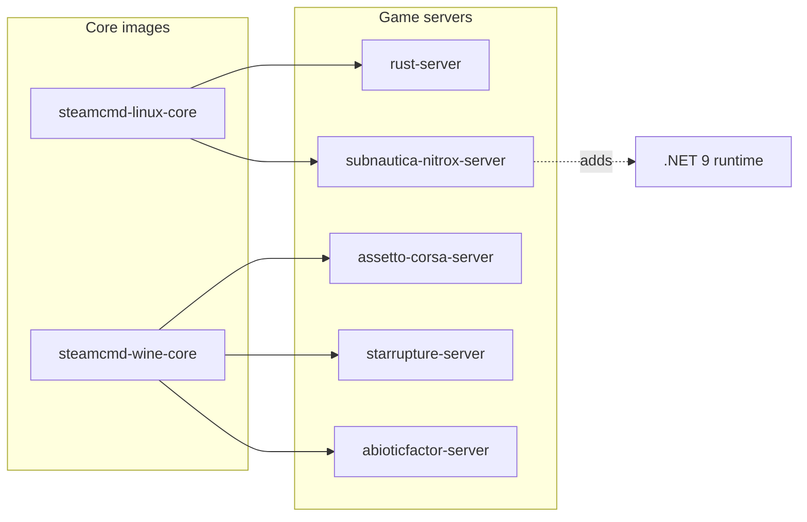

# steamcmd-servers by monolithoid

The goal of this project is to provide generic Docker bases for dedicated game servers:

- Linux servers managed with SteamCMD (`steamcmd-linux-core`)
- Windows servers executed with Wine (`steamcmd-wine-core`)

This repo contains:

- **Core images**
  - `monolithoid/steamcmd-linux-core`
  - `monolithoid/steamcmd-wine-core`
- **Per-game images**
  - `monolithoid/rust-server`
  - `monolithoid/assetto-corsa-server`
  - `monolithoid/starrupture-server`
  - `monolithoid/abioticfactor-server`
  - `monolithoid/subnautica-nitrox-server`

## Repository dependencies (Mermaid)



## Volumes and network access

- Persistent volumes mounted from Coolify (or plain Docker) must be writable by the in-container `steam` user (UID/GID `1000` by default).
- Open required ports on your firewall/router and in your orchestrator.

## Update strategy

### Linux servers (`steamcmd-linux-core`)

SteamCMD can still be used in-container, but recommended operations remain manual-first.

### Wine servers (`steamcmd-wine-core`)

Wine core is now a **runtime-only** image:

- no SteamCMD update at container startup,
- no in-container download logic,
- container only launches an already installed Windows dedicated server.


## VPS update script

`vps/updateGaming.sh` updates the host-mounted server binaries used by the runtime-only images. The script output is in English and writes SteamCMD logs to `/tmp/steamcmd-updates` by default.

Included targets:

- StarRupture dedicated server (`/opt/gaming/starrupture`)
- Abiotic Factor dedicated server (`/opt/gaming/abioticfactor`)
- Subnautica base game files (`/opt/gaming/subnautica`) plus Nitrox Linux x64 prerequisites (`/opt/gaming/subnautica-nitrox`)

Subnautica is not an anonymous Steam dedicated server app. Configure an account that owns the game before running the script:

```bash
export SUBNAUTICA_STEAM_USER="<steam_user>"
export SUBNAUTICA_STEAM_PASSWORD="<steam_password>"
# Optional when Steam Guard requires a one-time code:
export SUBNAUTICA_STEAM_GUARD_CODE="<steam_guard_code>"
./vps/updateGaming.sh
```

Useful overrides:

```bash
export LOG_DIR="/var/log/steamcmd-updates"
export SUBNAUTICA_ENABLED="1"
export SUBNAUTICA_INSTALL_DIR="/opt/gaming/subnautica"
export SUBNAUTICA_NITROX_DIR="/opt/gaming/subnautica-nitrox"
export SUBNAUTICA_NITROX_VERSION="latest"
export NITROX_OWNER_UID="1000"
export NITROX_OWNER_GID="1000"
```

Set `SUBNAUTICA_ENABLED=0` to skip Subnautica and Nitrox on hosts that only run the dedicated-server SteamCMD targets.

## Manual SteamCMD commands per included game

### Rust (AppID `258550`)

```bash
steamcmd \
  +force_install_dir /opt/gaming/rust \
  +login anonymous \
  +app_update 258550 validate \
  +quit
```

### Assetto Corsa Dedicated Server (AppID `302550`)

```bash
steamcmd \
  +@sSteamCmdForcePlatformType windows \
  +force_install_dir /opt/gaming/assetto-corsa \
  +login <steam_user> <steam_password> \
  +app_update 302550 validate \
  +quit
```

### StarRupture Dedicated Server (AppID `3809400`)

```bash
steamcmd \
  +@sSteamCmdForcePlatformType windows \
  +force_install_dir /opt/gaming/starrupture \
  +login <steam_user> <steam_password> \
  +app_update 3809400 validate \
  +quit
```

### Subnautica Nitrox Server

Nitrox is not distributed through SteamCMD. This image derives from `monolithoid/steamcmd-linux-core`, adds the .NET runtime required by Nitrox, and remains runtime-only. Copy a legal Subnautica Steam installation manually from your PC to `/opt/gaming/subnautica`, then install or update the Linux Nitrox release on the VPS and mount it into `/opt/nitrox`.

Preferred VPS update path:

```bash
NITROX_ENABLED=1 ./vps/updateGaming.sh
```

Host prerequisites for the Nitrox updater are `curl`, `python3`, `unzip`, and `rsync`.

To pin a specific Nitrox release:

```bash
NITROX_VERSION=1.8.1.0 ./vps/updateGaming.sh
```

The updater preserves `Nitrox/saves/` and `Nitrox/server.cfg`.

Manual fallback:

```bash
sudo mkdir -p /opt/gaming/subnautica-nitrox
cd /opt/gaming/subnautica-nitrox
sudo curl -fL \
  https://github.com/SubnauticaNitrox/Nitrox/releases/download/1.8.1.0/Nitrox_1.8.1.0_linux_x64.zip \
  -o nitrox.zip
sudo unzip -o nitrox.zip
sudo chmod +x Nitrox.Server.Subnautica
sudo chown -R 1000:1000 /opt/gaming/subnautica-nitrox
```

```bash
docker run -d \
  --name subnautica-nitrox \
  -p 11000:11000/udp \
  -p 11000:11000/tcp \
  -e SUBNAUTICA_INSTALLATION_PATH=/subnautica \
  -v /opt/gaming/subnautica:/subnautica:ro \
  -v /opt/gaming/subnautica-nitrox:/opt/nitrox \
  monolithoid/subnautica-nitrox-server:latest
```

### Subnautica Nitrox Server

Nitrox is not distributed through SteamCMD. This image derives from `monolithoid/steamcmd-linux-core`, adds the .NET runtime required by Nitrox, and remains runtime-only: install or update the Nitrox Linux release manually on the host, then mount it into `/opt/nitrox`. A legal Subnautica installation must also be mounted read-only into `/subnautica`.

```bash
sudo mkdir -p /opt/gaming/subnautica-nitrox
cd /opt/gaming/subnautica-nitrox
sudo curl -fL \
  https://github.com/SubnauticaNitrox/Nitrox/releases/download/1.8.1.0/Nitrox_1.8.1.0_linux_x64.zip \
  -o nitrox.zip
sudo unzip -o nitrox.zip
sudo chmod +x Nitrox.Server.Subnautica
sudo chown -R 1000:1000 /opt/gaming/subnautica-nitrox
```

```bash
docker run -d \
  --name subnautica-nitrox \
  -p 11000:11000/udp \
  -p 11000:11000/tcp \
  -e SUBNAUTICA_INSTALLATION_PATH=/subnautica \
  -v /opt/gaming/subnautica:/subnautica:ro \
  -v /opt/gaming/subnautica-nitrox:/opt/nitrox \
  monolithoid/subnautica-nitrox-server:latest
```

### Abiotic Factor Dedicated Server

This image is runtime-only on Wine core. Install/update server binaries manually on host, then mount them into `/opt/server`.
