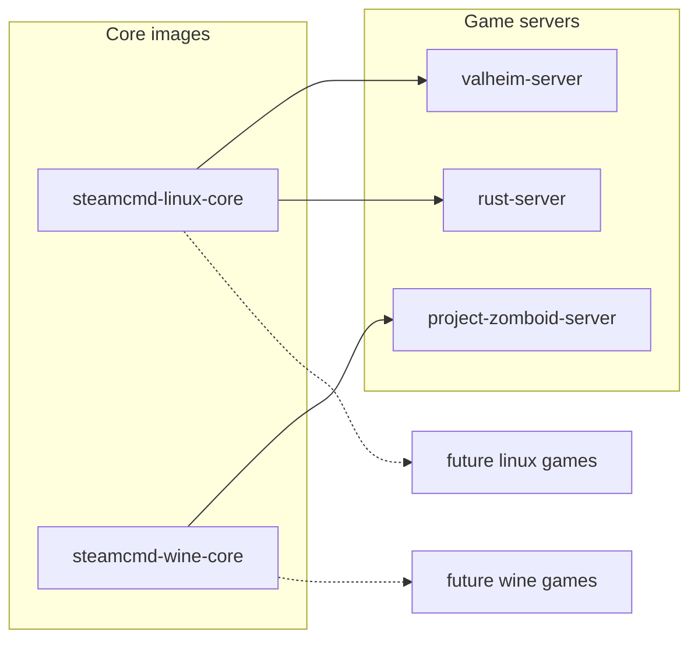

# steamcmd-servers by monolithoid

The goal of this project is to provide a generic base for any dedicated server running with SteamCMD and/or Wine.

This repo contains:

- **Generic** Docker images built on SteamCMD:
  - `monolithoid/steamcmd-linux-core`
  - `monolithoid/steamcmd-wine-core`
- **Per-game** Docker images, ready to use:
  - `monolithoid/valheim-server`
  - `monolithoid/project-zomboid-server`
  - `monolithoid/rust-server`
  - `monolithoid/assetto-corsa-server`
  - (and more to come)

Each game in `games/<name>` provides:

- a `Dockerfile` (based on a core image)
- a ready-to-copy/paste `docker-compose.yml` (Coolify, Portainer, etc.)
- a game-specific `README.md`

## Repository dependencies (Mermaid)

## Volumes and network access

- Persistent volumes mounted from Coolify (or plain Docker) must be writable by the in-container `steam` user (UID/GID 1000 by default). On the host that runs Coolify, adjust ownership on the target folder before deploying, for example: `sudo chown -R 1000:1000 /path/to/your/data`.
- Expose and open the game ports on your firewall/router (and in Coolify if applicable) so players can reach the server. Example on a Debian/Ubuntu host using UFW: `sudo ufw allow 2456:2458/udp` (adjust ports/protocols per game).
