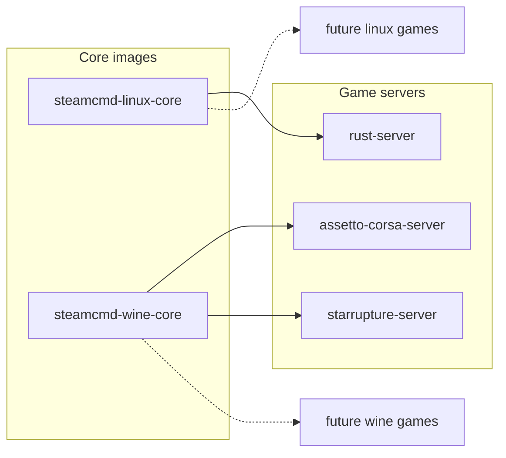

# steamcmd-servers by monolithoid

The goal of this project is to provide a generic base for any dedicated server running with SteamCMD and/or Wine.

This repo contains:

- **Generic** Docker images built on SteamCMD:
  - `monolithoid/steamcmd-linux-core`
  - `monolithoid/steamcmd-wine-core`
- **Per-game** Docker images, ready to use:
  - `monolithoid/rust-server`
  - `monolithoid/assetto-corsa-server`
  - `monolithoid/starrupture-server`
  - (and more to come)

Each game in `games/<name>` provides:

- a `Dockerfile` (based on a core image)
- a ready-to-copy/paste `docker-compose.yml` (Coolify, Portainer, etc.)
- a game-specific `README.md`

## Repository dependencies (Mermaid)



## Volumes and network access

- Persistent volumes mounted from Coolify (or plain Docker) must be writable by the in-container `steam` user (UID/GID 1000 by default). On the host that runs Coolify, adjust ownership on the target folder before deploying, for example: `sudo chown -R 1000:1000 /path/to/your/data`.
- Expose and open the game ports on your firewall/router (and in Coolify if applicable) so players can reach the server. Example on a Debian/Ubuntu host using UFW: `sudo ufw allow 2456:2458/udp` (adjust ports/protocols per game).


## Update strategy (manual-first)

SteamCMD update during container startup is now **disabled by default** across this repository (`STEAMCMD=0`).

Reasoning:

1. Steam connectivity can be intermittent.
2. Anonymous Steam access is not guaranteed for all app IDs.
3. Authenticated access can be blocked by Steam Guard in headless startup contexts.

### Recommended operations model

1. **Prepare binaries manually on the VPS** using a temporary maintenance run (`STEAMCMD=1`, `START_SERVER=0`).
2. **Keep runtime containers in stable mode** with `STEAMCMD=0` so restart operations do not depend on Steam availability.
3. **Perform updates in planned maintenance windows** only, then restart production containers.

This model reduces startup failures and gives explicit operator control over update timing.

### Manual update directly on the VPS (without Docker Compose)

If you prefer to run SteamCMD directly on the host, you can install SteamCMD on the VPS and update the mounted server directory before starting/restarting containers.

1. Install SteamCMD on the VPS (Debian/Ubuntu example):

```bash
sudo dpkg --add-architecture i386
sudo apt-get update
sudo apt-get install -y steamcmd
```

2. Update a Linux dedicated server directly into your persistent folder:

```bash
steamcmd \
  +force_install_dir /opt/gaming/my-linux-server \
  +login <steam_user> <steam_password> \
  +app_update <app_id> validate \
  +quit
```

3. Update a Windows dedicated server payload (for Wine runtime) from the VPS:

```bash
steamcmd \
  +@sSteamCmdForcePlatformType windows \
  +force_install_dir /opt/gaming/my-windows-server \
  +login <steam_user> <steam_password> \
  +app_update <app_id> validate \
  +quit
```

4. Ensure ownership for the runtime container user (UID/GID 1000), then restart your server container with `STEAMCMD=0`:

```bash
sudo chown -R 1000:1000 /opt/gaming/my-linux-server
```

Notes:
- Replace `<app_id>` with the dedicated server app ID.
- If the app supports anonymous access, you can use `+login anonymous`.
- If Steam Guard is requested, complete it once in an interactive VPS session, then rerun the command.

## Steam account mode (all core images)

`steamcmd-linux-core` and `steamcmd-wine-core` both support authenticated SteamCMD login.

- Default mode: `STEAM_LOGIN=anonymous`
- Authenticated mode: define `STEAM_LOGIN` and `STEAM_PASSWORD`

Example:

```bash
docker run --rm \
  -e STEAM_APP_ID=123456 \
  -e STEAM_LOGIN=my_steam_user \
  -e STEAM_PASSWORD='my_steam_password' \
  monolithoid/steamcmd-linux-core:latest
```

> You should pass credentials via Docker/Coolify secrets whenever possible, not plain text env vars.

## SteamCMD troubleshooting (generic)

### `ERROR! Failed to install app '<app_id>' (No subscription)`

This SteamCMD error usually means the current login does not own the requested app/tool license.

Recommended checks:

1. Confirm the Steam account owns the dedicated server app/tool for the target `STEAM_APP_ID`.
2. Retry with authenticated mode (`STEAM_LOGIN` + `STEAM_PASSWORD`) instead of `anonymous`.
3. Run SteamCMD once manually to complete any Steam Guard challenge.

Generic verification command:

```bash
steamcmd \
  +login <steam_user> <steam_password> \
  +app_update <app_id> validate \
  +quit
```
