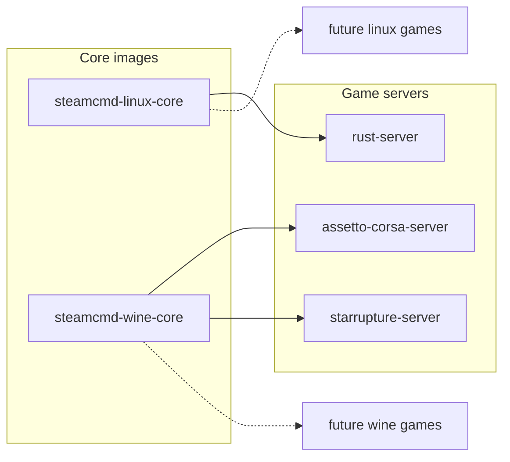

# steamcmd-servers by monolithoid

The goal of this project is to provide a generic base for any dedicated server running with SteamCMD and/or Wine.

This repo contains:

- **Generic** Docker images built on SteamCMD:
  - `monolithoid/steamcmd-linux-core`
  - `monolithoid/steamcmd-wine-core`
- **Per-game** Docker images, ready to use:
  - `monolithoid/rust-server`
  - `monolithoid/assetto-corsa-server`
  - `monolithoid/starrupture-server`
  - (and more to come)

Each game in `games/<name>` provides:

- a `Dockerfile` (based on a core image)
- a ready-to-copy/paste `docker-compose.yml` (Coolify, Portainer, etc.)
- a game-specific `README.md`

## Repository dependencies (Mermaid)



## Volumes and network access

- Persistent volumes mounted from Coolify (or plain Docker) must be writable by the in-container `steam` user (UID/GID 1000 by default). On the host that runs Coolify, adjust ownership on the target folder before deploying, for example: `sudo chown -R 1000:1000 /path/to/your/data`.
- Expose and open the game ports on your firewall/router (and in Coolify if applicable) so players can reach the server. Example on a Debian/Ubuntu host using UFW: `sudo ufw allow 2456:2458/udp` (adjust ports/protocols per game).


## Update strategy (recommended)

Managing game updates directly from the VPS (manual recurring action) can be useful for emergency control, but for day-to-day operations this repository is designed to be more reliable with an **image-centric workflow**:

1. Build/version a new image when the game startup logic changes.
2. Keep server binaries and saves in persistent volumes.
3. Run SteamCMD update/validate from container start or via scheduled container restart.

Why this is usually better than host-only manual updates:

- Reproducibility: same image/tag = same runtime behavior across environments.
- Rollback: you can pin a previous image tag quickly if an update breaks something.
- Lower drift: fewer host-specific scripts and less hidden VPS state.
- Easier automation: Coolify/Portainer and CI/CD naturally fit image updates.

A practical compromise is to use a **hybrid model**:

- Keep update logic in containers/images (source of truth).
- Trigger updates from the VPS using a controlled operation (for example, a weekly `docker compose pull && docker compose up -d` plus a maintenance window).
- Keep one manual emergency command path for hotfixes.

This gives operational control without losing reproducibility.

## Steam account mode (all core images)

`steamcmd-linux-core` and `steamcmd-wine-core` both support authenticated SteamCMD login.

- Default mode: `STEAM_LOGIN=anonymous`
- Authenticated mode: define `STEAM_LOGIN` and `STEAM_PASSWORD`

Example:

```bash
docker run --rm \
  -e STEAM_APP_ID=123456 \
  -e STEAM_LOGIN=my_steam_user \
  -e STEAM_PASSWORD='my_steam_password' \
  monolithoid/steamcmd-linux-core:latest
```

> You should pass credentials via Docker/Coolify secrets whenever possible, not plain text env vars.

## SteamCMD troubleshooting (generic)

### `ERROR! Failed to install app '<app_id>' (No subscription)`

This SteamCMD error usually means the current login does not own the requested app/tool license.

Recommended checks:

1. Confirm the Steam account owns the dedicated server app/tool for the target `STEAM_APP_ID`.
2. Retry with authenticated mode (`STEAM_LOGIN` + `STEAM_PASSWORD`) instead of `anonymous`.
3. Run SteamCMD once manually to complete any Steam Guard challenge.

Generic verification command:

```bash
steamcmd \
  +login <steam_user> <steam_password> \
  +app_update <app_id> validate \
  +quit
```
