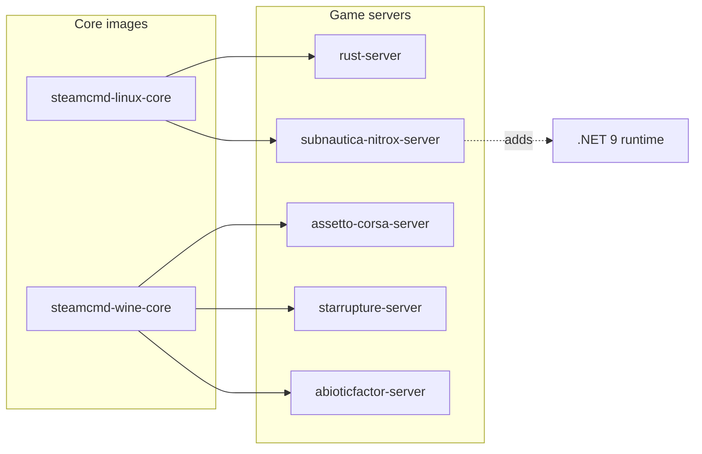

# steamcmd-servers by monolithoid

The goal of this project is to provide generic Docker bases for dedicated game servers:

- Linux servers managed with SteamCMD (`steamcmd-linux-core`)
- Windows servers executed with Wine (`steamcmd-wine-core`)

This repo contains:

- **Core images**
  - `monolithoid/steamcmd-linux-core`
  - `monolithoid/steamcmd-wine-core`
- **Per-game images**
  - `monolithoid/rust-server`
  - `monolithoid/assetto-corsa-server`
  - `monolithoid/starrupture-server`
  - `monolithoid/abioticfactor-server`
  - `monolithoid/subnautica-nitrox-server`

## Repository dependencies (Mermaid)



## Volumes and network access

- Persistent volumes mounted from Coolify (or plain Docker) must be writable by the in-container `steam` user (UID/GID `1000` by default).
- Open required ports on your firewall/router and in your orchestrator.

## Update strategy

The Docker images are runtime-focused: server files live on the host and are mounted into the containers. The recommended update workflow is now split by authentication type:

- **VPS side**: run `vps/updateGaming.sh` directly on the VPS for anonymous SteamCMD dedicated-server apps and host prerequisites such as Nitrox.
- **PC side**: run `pc/updateGaming.sh` on a trusted PC for Steam apps that require an account, then copy the updated files to the VPS through SSH/rsync.

See the full operational guide in [`docs/update-workflow.md`](docs/update-workflow.md).

### VPS update script

`vps/updateGaming.sh` updates host-mounted files that do not require storing Steam account credentials on the VPS. It writes SteamCMD logs to `/tmp/steamcmd-updates` by default.

Default targets:

- Rust dedicated server (`/opt/gaming/rust`) with anonymous SteamCMD login.
- StarRupture dedicated server (`/opt/gaming/starrupture`) with anonymous SteamCMD login.
- Abiotic Factor dedicated server (`/opt/gaming/abioticfactor`) with anonymous SteamCMD login.
- Nitrox Linux x64 prerequisite (`/opt/gaming/subnautica-nitrox`) from GitHub releases.

Example:

```bash
./vps/updateGaming.sh
```

Useful overrides can be placed in `vps/updateGaming.env` (copy `vps/updateGaming.env.example` first) so you can run the script without preparing exported variables:

```bash
cp vps/updateGaming.env.example vps/updateGaming.env
$EDITOR vps/updateGaming.env
./vps/updateGaming.sh
```

The same values can still be passed inline for one-off runs:

```bash
LOG_DIR="/var/log/steamcmd-updates" \
SERVER_OWNER="1000:1000" \
RUST_ENABLED="1" \
STARRUPTURE_ENABLED="1" \
ABIOTIC_FACTOR_ENABLED="1" \
NITROX_ENABLED="1" \
NITROX_VERSION="latest" \
SUBNAUTICA_INSTALL_DIR="/opt/gaming/subnautica" \
./vps/updateGaming.sh
```

### PC update and copy script

`pc/updateGaming.sh` updates account-bound Steam apps locally and synchronizes the updated app directories to the VPS over SSH.

Default targets:

- Assetto Corsa Dedicated Server (`302550`) copied to `/opt/gaming/assetto-corsa`.
- Subnautica (`264710`) copied to `/opt/gaming/subnautica` for the Nitrox server.

Run the script directly from a Bash-compatible environment:

```bash
./pc/updateGaming.sh
```

On the first interactive run, the script asks for the Steam login, Steam password, VPS SSH login, and VPS URL/IP. It remembers only the non-secret values (`STEAM_LOGIN`, `VPS_LOGIN`, and `VPS_URL`) in `~/.steamcmd-servers-pc.env` with `0600` permissions; later runs only need the Steam password and optional Steam Guard code. It never writes the Steam password or Steam Guard code to the cache. SteamCMD itself does not support reusing an already-open browser or Steam client session for these downloads, so the safe fallback is the console prompt.

PowerShell can start the PC updater only through a Bash-compatible environment, for example WSL or Git Bash:

```powershell
bash ./pc/updateGaming.sh
```

This does not change Steam authentication: SteamCMD still uses its own console login flow and cannot inherit a browser or desktop Steam session opened from PowerShell. Make sure `steamcmd`, `ssh`, and `rsync` are installed in the same Bash environment that runs the script.

Do not copy Steam tokens, sentry files, `config.vdf`, cookies, or other cached Steam session files between machines or user profiles. Those files are bearer-style session material: copying them is fragile, can bypass the account protections you expect, and creates another secret to protect. If SteamCMD chooses to remember a trusted login on the same computer after a Steam Guard challenge, leave that cache managed by SteamCMD in that local environment instead of scripting token copies.

For one-off non-interactive runs, the Steam values can still be provided inline, but this is less safe because credentials may be visible to the shell environment or process tooling:

```bash
STEAM_LOGIN="<steam_user>" \
STEAM_PASSWORD="<steam_password>" \
VPS_LOGIN="<ssh_user>" \
VPS_URL="<vps_host>" \
./pc/updateGaming.sh
```

If `STEAM_LOGIN`, `STEAM_PASSWORD`, `VPS_LOGIN`, or `VPS_URL` is missing and the script is attached to a terminal, it asks for the missing value. Non-secret answers are saved to the hidden prompt cache for later runs unless `PC_REMEMBER_PROMPT_VALUES=0` is set.

If Steam Guard requires a one-time code, let SteamCMD ask for it in the terminal during login. For automation only, you can still pass a one-time value inline:

```bash
STEAM_GUARD_CODE="<steam_guard_code>" ./pc/updateGaming.sh
```


### VPS firewall configuration script

`vps/configureGaming.sh` opens the default game ports on a VPS that uses UFW. It is separate from the update scripts because firewall changes are host configuration, not app updates.

Default openings:

- Rust: `28015/udp`, `28016/udp`, `28017/tcp`.
- Assetto Corsa: `9600/tcp`, `9600/udp`, `8081/tcp`.
- StarRupture: `7777/udp`.
- Abiotic Factor: `7777/udp`, `27015/udp`.
- Subnautica Nitrox: `11000/udp`, `11000/tcp`.

If you need persistent firewall overrides, copy `vps/configureGaming.env.example` to `vps/configureGaming.env` and edit it before running the script.

Preview the commands without changing the firewall:

```bash
DRY_RUN=1 ./vps/configureGaming.sh
```

Apply the rules on the VPS:

```bash
sudo ./vps/configureGaming.sh
```

## Manual SteamCMD commands per included game

### Rust (AppID `258550`)

```bash
steamcmd \
  +force_install_dir /opt/gaming/rust \
  +login anonymous \
  +app_update 258550 validate \
  +quit
```

### Assetto Corsa Dedicated Server (AppID `302550`)

Use the PC updater for this account-bound app, or run manually on a trusted machine:

```bash
steamcmd \
  +@sSteamCmdForcePlatformType windows \
  +force_install_dir /opt/gaming/assetto-corsa \
  +login <steam_user> <steam_password> \
  +app_update 302550 validate \
  +quit
```

### StarRupture Dedicated Server (AppID `3809400`)

```bash
steamcmd \
  +@sSteamCmdForcePlatformType windows \
  +force_install_dir /opt/gaming/starrupture \
  +login anonymous \
  +app_update 3809400 validate \
  +quit
```

### Abiotic Factor Dedicated Server (AppID `2857200`)

```bash
steamcmd \
  +@sSteamCmdForcePlatformType windows \
  +force_install_dir /opt/gaming/abioticfactor \
  +login anonymous \
  +app_update 2857200 validate \
  +quit
```

### Subnautica Nitrox Server

Nitrox is not distributed through SteamCMD. This image derives from `monolithoid/steamcmd-linux-core`, adds the .NET runtime required by Nitrox, and remains runtime-only. Use the PC updater to copy a legal Subnautica Steam installation to `/opt/gaming/subnautica`, then use the VPS updater to install or update the Linux Nitrox release in `/opt/gaming/subnautica-nitrox`.

Preferred workflow:

```bash
# On the PC
# The script asks for secrets in the terminal and caches only non-secret values.
VPS_LOGIN=<ssh_user> VPS_URL=<vps_host> ./pc/updateGaming.sh

# On the VPS
NITROX_ENABLED=1 ./vps/updateGaming.sh
```

Host prerequisites for the Nitrox updater are `curl`, `python3`, `unzip`, and `rsync`. To pin a specific Nitrox release:

```bash
NITROX_VERSION=1.8.1.0 ./vps/updateGaming.sh
```

The updater preserves `Nitrox/saves/` and `Nitrox/server.cfg`.

```bash
docker run -d \
  --name subnautica-nitrox \
  -p 11000:11000/udp \
  -p 11000:11000/tcp \
  -e SUBNAUTICA_INSTALLATION_PATH=/subnautica \
  -v /opt/gaming/subnautica:/subnautica:ro \
  -v /opt/gaming/subnautica-nitrox:/opt/nitrox \
  monolithoid/subnautica-nitrox-server:latest
```
