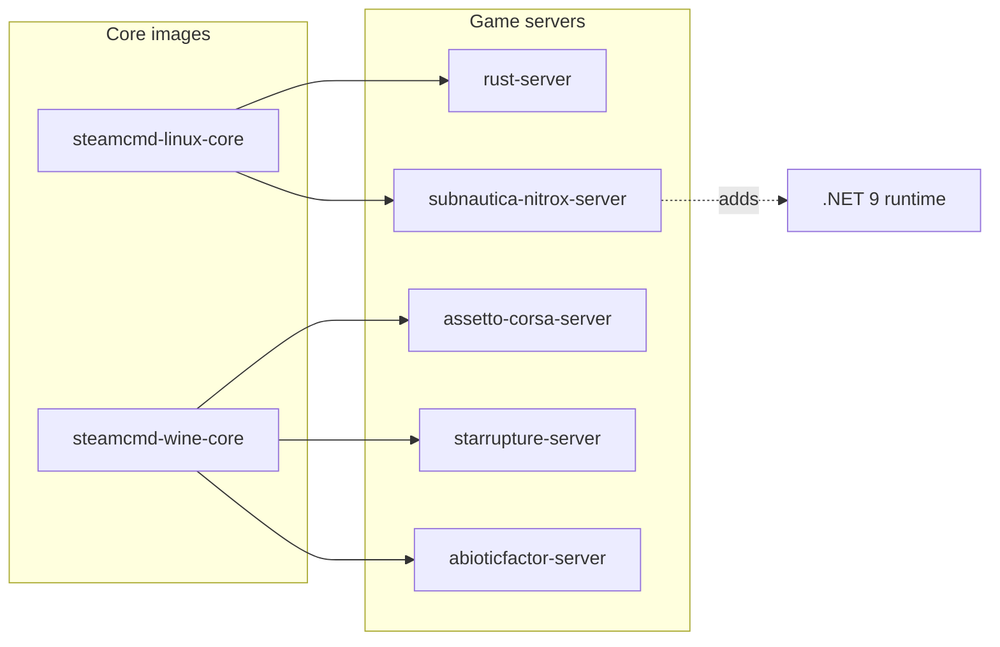

# steamcmd-servers by monolithoid

The goal of this project is to provide generic Docker bases for dedicated game servers:

- Linux servers managed with SteamCMD (`steamcmd-linux-core`)
- Windows servers executed with Wine (`steamcmd-wine-core`)

This repo contains:

- **Core images**
  - `monolithoid/steamcmd-linux-core`
  - `monolithoid/steamcmd-wine-core`
- **Per-game images**
  - `monolithoid/rust-server`
  - `monolithoid/assetto-corsa-server`
  - `monolithoid/starrupture-server`
  - `monolithoid/abioticfactor-server`
  - `monolithoid/subnautica-nitrox-server`

## Repository dependencies (Mermaid)



## Volumes and network access

- Persistent volumes mounted from Coolify (or plain Docker) must be writable by the in-container `steam` user (UID/GID `1000` by default).
- Open required ports on your firewall/router and in your orchestrator.

## Update strategy

The Docker images are runtime-focused: server files live on the host and are mounted into the containers. The recommended update workflow is now split by authentication type:

- **VPS side**: run `vps/updateGaming.sh` directly on the VPS for anonymous SteamCMD dedicated-server apps and host prerequisites such as Nitrox.
- **PC side**: run `pc/updateGaming.sh` on a trusted PC for Steam apps that require an account, then copy the updated files to the VPS through SSH/rsync.

See the full operational guide in [`docs/update-workflow.md`](docs/update-workflow.md).

### VPS update script

`vps/updateGaming.sh` updates host-mounted files that do not require storing Steam account credentials on the VPS. It writes SteamCMD logs to `/tmp/steamcmd-updates` by default.

Default targets:

- Rust dedicated server (`/opt/gaming/rust`) with anonymous SteamCMD login.
- StarRupture dedicated server (`/opt/gaming/starrupture`) with anonymous SteamCMD login.
- Abiotic Factor dedicated server (`/opt/gaming/abioticfactor`) with anonymous SteamCMD login.
- Nitrox Linux x64 prerequisite (`/opt/gaming/subnautica-nitrox`) from GitHub releases.

Example:

```bash
./vps/updateGaming.sh
```

Useful overrides:

```bash
export LOG_DIR="/var/log/steamcmd-updates"
export SERVER_OWNER="1000:1000"
export RUST_ENABLED="1"
export STARRUPTURE_ENABLED="1"
export ABIOTIC_FACTOR_ENABLED="1"
export NITROX_ENABLED="1"
export NITROX_VERSION="latest"
export SUBNAUTICA_INSTALL_DIR="/opt/gaming/subnautica"
./vps/updateGaming.sh
```

### PC update and copy script

`pc/updateGaming.sh` updates account-bound Steam apps locally and synchronizes the updated app directories to the VPS over SSH.

Default targets:

- Assetto Corsa Dedicated Server (`302550`) copied to `/opt/gaming/assetto-corsa`.
- Subnautica (`264710`) copied to `/opt/gaming/subnautica` for the Nitrox server.

Example:

```bash
export STEAM_LOGIN="<steam_user>"
export STEAM_PASSWORD="<steam_password>"
export VPS_SSH_TARGET="<ssh_user>@<vps_host>"
./pc/updateGaming.sh
```

If Steam Guard requires a one-time code:

```bash
export STEAM_GUARD_CODE="<steam_guard_code>"
./pc/updateGaming.sh
```

Common copy overrides:

```bash
export VPS_SSH_PORT="22"
export VPS_BASE_DIR="/opt/gaming"
export VPS_OWNER="1000:1000"
export VPS_RSYNC_PATH="sudo rsync"
export PC_RSYNC_DELETE="1"
```


### VPS firewall configuration script

`vps/configureGaming.sh` opens the default game ports on a VPS that uses UFW. It is separate from the update scripts because firewall changes are host configuration, not app updates.

Default openings:

- Rust: `28015/udp`, `28016/udp`, `28017/tcp`.
- Assetto Corsa: `9600/tcp`, `9600/udp`, `8081/tcp`.
- StarRupture: `7777/udp`.
- Abiotic Factor: `7777/udp`, `27015/udp`.
- Subnautica Nitrox: `11000/udp`, `11000/tcp`.

Preview the commands without changing the firewall:

```bash
DRY_RUN=1 ./vps/configureGaming.sh
```

Apply the rules on the VPS:

```bash
sudo ./vps/configureGaming.sh
```

## Manual SteamCMD commands per included game

### Rust (AppID `258550`)

```bash
steamcmd \
  +force_install_dir /opt/gaming/rust \
  +login anonymous \
  +app_update 258550 validate \
  +quit
```

### Assetto Corsa Dedicated Server (AppID `302550`)

Use the PC updater for this account-bound app, or run manually on a trusted machine:

```bash
steamcmd \
  +@sSteamCmdForcePlatformType windows \
  +force_install_dir /opt/gaming/assetto-corsa \
  +login <steam_user> <steam_password> \
  +app_update 302550 validate \
  +quit
```

### StarRupture Dedicated Server (AppID `3809400`)

```bash
steamcmd \
  +@sSteamCmdForcePlatformType windows \
  +force_install_dir /opt/gaming/starrupture \
  +login anonymous \
  +app_update 3809400 validate \
  +quit
```

### Abiotic Factor Dedicated Server (AppID `2857200`)

```bash
steamcmd \
  +@sSteamCmdForcePlatformType windows \
  +force_install_dir /opt/gaming/abioticfactor \
  +login anonymous \
  +app_update 2857200 validate \
  +quit
```

### Subnautica Nitrox Server

Nitrox is not distributed through SteamCMD. This image derives from `monolithoid/steamcmd-linux-core`, adds the .NET runtime required by Nitrox, and remains runtime-only. Use the PC updater to copy a legal Subnautica Steam installation to `/opt/gaming/subnautica`, then use the VPS updater to install or update the Linux Nitrox release in `/opt/gaming/subnautica-nitrox`.

Preferred workflow:

```bash
# On the PC
STEAM_LOGIN=<steam_user> \
STEAM_PASSWORD=<steam_password> \
VPS_SSH_TARGET=<ssh_user>@<vps_host> \
./pc/updateGaming.sh

# On the VPS
NITROX_ENABLED=1 ./vps/updateGaming.sh
```

Host prerequisites for the Nitrox updater are `curl`, `python3`, `unzip`, and `rsync`. To pin a specific Nitrox release:

```bash
NITROX_VERSION=1.8.1.0 ./vps/updateGaming.sh
```

The updater preserves `Nitrox/saves/` and `Nitrox/server.cfg`.

```bash
docker run -d \
  --name subnautica-nitrox \
  -p 11000:11000/udp \
  -p 11000:11000/tcp \
  -e SUBNAUTICA_INSTALLATION_PATH=/subnautica \
  -v /opt/gaming/subnautica:/subnautica:ro \
  -v /opt/gaming/subnautica-nitrox:/opt/nitrox \
  monolithoid/subnautica-nitrox-server:latest
```
