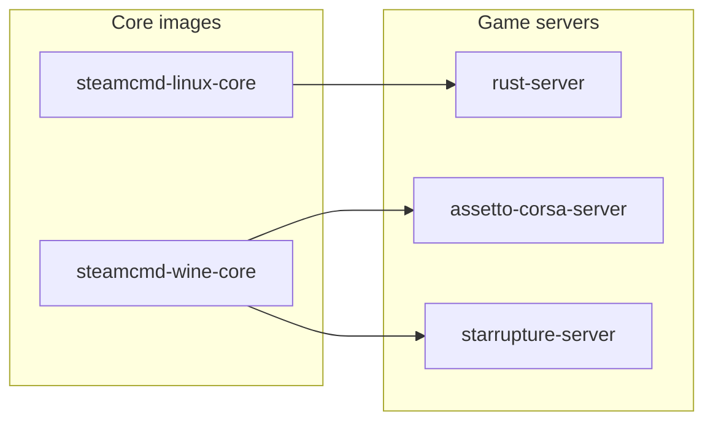

# steamcmd-servers by monolithoid

The goal of this project is to provide generic Docker bases for dedicated game servers:

- Linux servers managed with SteamCMD (`steamcmd-linux-core`)
- Windows servers executed with Wine (`steamcmd-wine-core`)

This repo contains:

- **Core images**
  - `monolithoid/steamcmd-linux-core`
  - `monolithoid/steamcmd-wine-core`
- **Per-game images**
  - `monolithoid/rust-server`
  - `monolithoid/assetto-corsa-server`
  - `monolithoid/starrupture-server`

## Repository dependencies (Mermaid)



## Volumes and network access

- Persistent volumes mounted from Coolify (or plain Docker) must be writable by the in-container `steam` user (UID/GID `1000` by default).
- Open required ports on your firewall/router and in your orchestrator.

## Update strategy

### Linux servers (`steamcmd-linux-core`)

SteamCMD can still be used in-container, but recommended operations remain manual-first.

### Wine servers (`steamcmd-wine-core`)

Wine core is now a **runtime-only** image:

- no SteamCMD update at container startup,
- no in-container download logic,
- container only launches an already installed Windows dedicated server.

## Manual SteamCMD commands per included game

### Rust (AppID `258550`)

```bash
steamcmd \
  +force_install_dir /opt/gaming/rust \
  +login anonymous \
  +app_update 258550 validate \
  +quit
```

### Assetto Corsa Dedicated Server (AppID `302550`)

```bash
steamcmd \
  +@sSteamCmdForcePlatformType windows \
  +force_install_dir /opt/gaming/assetto-corsa \
  +login <steam_user> <steam_password> \
  +app_update 302550 validate \
  +quit
```

### StarRupture Dedicated Server (AppID `3809400`)

```bash
steamcmd \
  +@sSteamCmdForcePlatformType windows \
  +force_install_dir /opt/gaming/starrupture \
  +login <steam_user> <steam_password> \
  +app_update 3809400 validate \
  +quit
```
